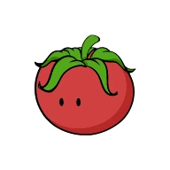

<div align="center">


# Kaisou

### Immersive AniList client for Android

<br/>

[](https://github.com/Zev-Kaapor/Kaisou/releases)
[](https://github.com/Zev-Kaapor/Kaisou/blob/main/LICENSE)
[](https://github.com/Zev-Kaapor/Kaisou)
[](https://github.com/Zev-Kaapor/Kaisou/releases)
[](#download-now)

<br/>

[](#status)
[](#download-now)
[](#features)
[](#translations)
[](#faq)
[](#support-the-project)

</div>

<details><summary><b>📋 Table of Contents</b></summary>

- [🧭 Overview](#overview)
- [📅 Status](#status)
- [⚙️ Features](#features)
- [📥 Download Now](#download-now)
- [🛠️ Build](#build)
- [❓ FAQ](#faq)
- [🌍 Translations](#translations)
- [💖 Support the Project](#support-the-project)
- [✨ Special Thanks](#special-thanks)
- [📜 License](#license)
- [👥 Contributors](#contributors)
- [⚖️ Disclaimer](#disclaimer)

</details>

> [!WARNING]
> **Early version** - Kaisou is being built one screen at a time. Version 0.0.1 has the sign in with AniList and the Home, and most buttons and tabs are still empty. It is a first version to be tested, not a finished app.

> [!NOTE]
> **Your privacy** - Kaisou has no server of its own and does not track you. Your AniList access key is kept only on your phone and is left out of the Android backups. The app only talks to the services it needs: AniList for your account and your lists, TMDB, TheTVDB and ani.zip to find the posters, the logos, the ratings and the seasons of each title (the name and the id of the title are sent), MyAnimeList for the age rating (the id of the title is sent), Google Translate when a synopsis is translated (only the text of the synopsis is sent), and GitHub to look for a new version. More in the [FAQ](#faq).

---

<!-- OVERVIEW - Project overview -->
<div align="center">

<h1><a id="overview"></a>Overview</h1>
<em>Kaisou is an AniList client for Android, designed to feel immersive, light and as refined as the big streaming apps.</em>

<br>

<p align="center">An open-source project made with care for the details of every screen, for the people who love anime and manga and keep their lists on AniList.</p>

</div>

---

<!-- STATUS - Where the project is -->
<div align="center">

<h1><a id="status"></a>Status</h1>

</div>

Kaisou grows one small piece at a time, with every screen reviewed on a real phone before the next one begins, and the structure of an earlier app, Wavvy, as the base of its identity. Version 0.0.1 is the first release of the new app, with the sign in and the Home.

<details>
<summary><b>📅 Progress by version</b> • every step, from the first version</summary>

<br>

| Step | State |
| :--- | :--- |
| **Project base:** build, signed releases, automated release workflow, logo and icon | ✅ Done, version 0.0.1 |
| **Theme and navigation:** colors, typography and shapes, a bottom bar in portrait and a side rail in landscape | ✅ Done, version 0.0.1 |
| **Sign in:** with AniList in the browser or with a token, kept only on the phone | ✅ Done, version 0.0.1 |
| **Home:** the header with your numbers and the featured titles of the season, with their poster or wide picture, logo, age rating, season and synopsis in your language | ✅ Done, version 0.0.1 |
| **Menu of the account, settings and about:** sign out, the version, the thanks, and the updates that look, download and install the new releases | ✅ Done, version 0.0.1 |
| **Explore, Calendar and Library:** the other three tabs | 🔜 Planned |
| **Title page, search and notifications:** the page of a title with its episodes, the search and the notices of AniList | 🔜 Planned |
| **Your profile and your lists:** the lists of anime and manga, with the progress | 🔜 Planned |
| **Extensions:** support for the sources the user adds, with none of them included | 🔜 Planned |

</details>

---

<!-- FEATURES - What the project does -->
<div align="center">

<h1><a id="features"></a>Features</h1>

</div>

Everything the project does, in groups you can open. ✅ is already done, 🚧 is being built and 🔜 is planned.

<details>
<summary><b>🔜 Planned</b> (what comes next)</summary>

<br>

- The other tabs: Explore, Calendar and Library
- The page of a title, with its episodes, and the search
- Your lists of anime and manga, and the activity of the people you follow
- The notices of AniList and your profile
- Extensions for the sources the user adds
- A setting for the country of the age ratings, apart from the language

Do you have another idea? [Open an issue](https://github.com/Zev-Kaapor/Kaisou/issues/new) and tell it.

</details>

<details>
<summary><b>🚧 In progress</b> (what is being built)</summary>

<br>

Nothing is being built right now.

</details>

<details>
<summary><b>✅ Complete</b> (everything the project does today)</summary>

<br>

<table>
  <tr>
    <td width="50%" valign="top">

#### 🔐 Account
- Sign in with your **AniList** account, in the browser or with a token
- The access key stays only on the phone and is left out of the Android backups
- Sign out whenever you want, and revoke the access in the settings of AniList

#### 🏠 Home
- The header with your name, the episodes you watched and the chapters you read
- The **featured titles** of the season, one at a time, in a carousel that you can swipe
- The **poster** in high quality when standing up and a **wide picture** when lying down, chosen from TMDB and TheTVDB, with the cover of AniList as the last choice
- The **logo** of the title in place of its name, when there is one that can be seen
- The **age rating** of your country, with the official Brazilian symbols, and the ones of the other countries as a tag
- The **season** of the title and the tag of the day of the week of its new episode
- The **synopsis in your language**, translated when it is not English

#### 🎨 Look
- A dark theme with a violet identity, made for the night
- Every screen **standing up and lying down**, with a bar at the bottom or a rail at the side
- Placeholders with the shape of what is coming, so nothing jumps

</td>
    <td width="50%" valign="top">

#### 🔄 Updates
- Looks at the releases of the app by itself, every time it opens and every few hours
- Downloads the file that fits your phone and installs it
- Shows what changed in each version, and translates it
- Choose how often to look, or pause the lookups

#### 🌍 Languages
- **English** and **Brazilian Portuguese**, the one of your phone by default

#### ⚡ Light and fast
- Pictures, ratings and translations are kept on the phone, so opening the app again does not ask for them again
- Each service has a limit of requests at once, and the app waits when one asks it to rest
- A small app, around 2 MB

#### ℹ️ About
- The version, the author, the license and the page of the project
- The thanks to every project, site and app that made Kaisou possible

</td>
  </tr>
</table>

</details>

<div align="center">

<br>

<em>Built with <b>Kotlin</b> and <b>Jetpack Compose</b> for a result that feels fast, responsive and beautiful.</em>

</div>

---

<!-- DOWNLOAD - Downloads -->
<div align="center">

<h1><a id="download-now"></a>Download Now</h1>

[](https://github.com/Zev-Kaapor/Kaisou/releases)

</div>

A new release with signed APKs is published on GitHub every time the app version changes. Pick the one that fits your phone:

| APK | When to use it |
| :--- | :--- |
| **arm64-v8a** | Most phones from 2017 onwards, the best choice for almost everyone. |
| **armeabi-v7a** | Older 32-bit phones. |
| **universal** | Works on any phone, in a larger file. Pick this one if you are not sure. |

Kaisou needs **Android 8.0 (API 26)** or newer. To install, open the file on your phone and, when Android asks, allow your browser or your file manager to install apps.

After the first install the app looks for a new version by itself: every time it opens and every few hours, and it tells you with a notification. In **Settings → About → Versions** you can see what changed, download and install it, choose how often to look or pause the lookups. This works as long as the first install also came from here, because an app built in Android Studio is signed with another key and cannot be replaced by a release.

---

<!-- BUILD - Build from source -->
<div align="center">

<h1><a id="build"></a>Build</h1>

</div>

To build Kaisou yourself you need:

- **Android Studio** in a current version, or only the command line
- **Android SDK Platform 37**, which Android Studio offers to install when you open the project
- **A JDK 21 or newer** to start Gradle. The releases of the project are built with JDK 25
- An internet connection on the first build, to download Gradle and the libraries

**1. Get the code**

```bash
git clone https://github.com/Zev-Kaapor/Kaisou.git
cd Kaisou
```

**2. Build a version to test**

In Android Studio, open the folder, wait for the sync and press Run with your phone connected. Or in the terminal, on Windows with `gradlew.bat` in place of `./gradlew`:

```bash
./gradlew assembleDebug
```

The APKs, one for each kind of phone and a universal one, are in `app/build/outputs/apk/debug/`. To put one on your phone with adb:

```bash
adb install -r app/build/outputs/apk/debug/app-arm64-v8a-debug.apk
```

**3. Build a release**

```bash
./gradlew assembleRelease
```

The APKs are in `app/build/outputs/apk/release/`, smaller than the debug ones because the code and the resources are shrunk. The releases of the project are signed with its own key, which is kept in the secrets of the repository. A build of yours is signed with the debug key, so it installs, but it does not update one of the releases and the other way around: one has to be removed before the other is installed.

**4. The keys of the services**

Kaisou asks the services for the pictures, the ratings and the sign in, and each one needs a key of yours, which the services give for free. Put them in the file `local.properties` at the root of the project, which Git does not keep:

```properties
anilist.clientId=your client id
tmdb.token=your read access token
tvdb.key=your project key
mal.clientId=your client id
```

For the sign in, register a client on [AniList](https://anilist.co/settings/developer) with the redirect address `kaisou://anilist`. The other keys come from [TMDB](https://www.themoviedb.org/settings/api), [TheTVDB](https://thetvdb.com/api-information) and [MyAnimeList](https://myanimelist.net/apiconfig).

Without them the app builds and works with less: no key of AniList means no sign in in the browser, only with a token, without the keys of TMDB and TheTVDB the featured titles show the cover of AniList, and without the one of MyAnimeList the age rating of a country that has none is not found.

**How a release is made**

The workflow in `.github/workflows/release.yml` publishes a release when `appVersionName` changes in `app/build.gradle.kts`. It builds and signs the APKs, writes the notes from the commits since the last release and publishes them on GitHub. It reads the key of the signing and the keys of the services from the secrets of the repository: `KEYSTORE_BASE64`, `KEYSTORE_PASSWORD`, `KEY_ALIAS`, `KEY_PASSWORD`, `ANILIST_CLIENT_ID`, `TMDB_TOKEN`, `TVDB_KEY` and `MAL_CLIENT_ID`.

---

<!-- FAQ - Frequently asked questions -->
<div align="center">

<h1><a id="faq"></a>FAQ</h1>

</div>

<details>
  <summary><b>Is Kaisou free to use?</b></summary>
  <br>
  Yes, Kaisou is completely free and open-source, with no ads, no premium subscriptions and no hidden costs.
  <br>
</details>

<details>
  <summary><b>Do I need an AniList account?</b></summary>
  <br>
  Yes. Kaisou is a client for AniList, so it opens only for a signed in user. If you do not have an account yet, the sign in screen has a link to create one for free.
  <br>
</details>

<details>
  <summary><b>Is it safe to sign in?</b></summary>
  <br>
  The sign in happens in your browser, on the site of AniList, and AniList sends the access key back to the app. The key is kept only on your phone, Kaisou has no server of its own and the key is left out of the Android backups. AniList has no limited permissions, so the key gives access to almost everything in your account, and you can revoke it at any time in the settings of your AniList account.
  <br>
</details>

<details>
  <summary><b>Does Kaisou play anime?</b></summary>
  <br>
  Not for now. Kaisou shows the catalog and your lists. It does not host, store or provide any video, and the support for sources that the user adds is planned, with none of them included.
  <br>
</details>

<details>
  <summary><b>Is the app ready to use?</b></summary>
  <br>
  Not yet. Version 0.0.1 is the first release, with the sign in and the Home, and most buttons and tabs are still empty. See what it does in the <a href="#features">Features</a> section.
  <br>
</details>

<details>
  <summary><b>Which APK should I download?</b></summary>
  <br>
  Most phones from 2017 onwards can use <b>arm64-v8a</b>, and older 32-bit phones need <b>armeabi-v7a</b>. If you are not sure, take the <b>universal</b> one, which works on any phone in a larger file.
  <br>
</details>

<details>
  <summary><b>Which Android versions does it support?</b></summary>
  <br>
  Android 8.0 (API 26) and newer.
  <br>
</details>

<details>
  <summary><b>How do I update the app?</b></summary>
  <br>
  The app looks for a new version by itself, every time it opens and every few hours, and tells you with a notification. In <b>Settings → About → Versions</b> you can see what changed, download and install it, choose how often to look or pause the lookups. This works if the first install also came from the releases here, because an app built by another key, such as one made in Android Studio, cannot be replaced by a release.
  <br>
</details>

<details>
  <summary><b>Why does a title show the cover instead of the poster?</b></summary>
  <br>
  The posters, the logos and the wide pictures come from TMDB and TheTVDB, and some titles, mostly the newest ones, are not there yet. When there is nothing sharp enough, Kaisou shows the cover of AniList and the name of the title in text.
  <br>
</details>

<details>
  <summary><b>Where does the age rating come from?</b></summary>
  <br>
  From the rating that the country of your phone gives to the title, as TMDB has it, with the official symbols for Brazil. When your country has none, the rating of MyAnimeList is used, and then the one of another country, as an approximation, and the screen readers say so.
  <br>
</details>

<details>
  <summary><b>Does it collect my personal data?</b></summary>
  <br>
  No. Kaisou has no server of its own and no analytics. Your access key and your account stay on your phone. The services it talks to are listed in the note at the top of this page.
  <br>
</details>

<details>
  <summary><b>What license does the project use?</b></summary>
  <br>
  Kaisou is free software under the <a href="https://github.com/Zev-Kaapor/Kaisou/blob/main/LICENSE">GNU General Public License v3.0</a>. You can use it, study it, change it and share it, as long as the changes you share stay under the same license.
  <br>
</details>

<details>
  <summary><b>How do I report a bug?</b></summary>
  <br>
  <a href="https://github.com/Zev-Kaapor/Kaisou/issues/new">Open an issue</a> and tell what you did, what you expected and what happened. Mention the version of the app, the model of your phone and the version of Android.
  <br>
</details>

<details>
  <summary><b>How can I contribute?</b></summary>
  <br>
  Open an issue with a bug, an idea or a text that is not right, or send a pull request. Kaisou is built one screen at a time, so it is best to talk about it in an issue first.
  <br>
</details>

<div align="center">

<h3>More questions? <a href="https://github.com/Zev-Kaapor/Kaisou/issues">Open an issue on GitHub!</a></h3>

</div>

---

<!-- TRANSLATIONS - Translations -->
<div align="center">

<h1><a id="translations"></a>Translations</h1>

</div>

The app is available in **English**, which is the default, and **Brazilian Portuguese**, and it uses the one of your phone. The texts are in `app/src/main/res/values` and `app/src/main/res/values-pt-rBR`.

Found a text that is not right? [Open an issue](https://github.com/Zev-Kaapor/Kaisou/issues/new) or send a pull request with the fix. Want to see another language? Tell which one in an issue.

---

<!-- SUPPORT - Support the project -->
<div align="center">

<h1><a id="support-the-project"></a>Support the Project, Visitor! 👋</h1>

<h3>Kaisou is free and open-source. If you liked it, a star on this repository is the best way to say thanks! ⭐</h3>

<a href="https://github.com/Zev-Kaapor/Kaisou">
  
</a>

<h5>A star, a share with a friend or a <a href="https://github.com/Zev-Kaapor/Kaisou/issues/new">suggestion</a> already means a lot. Thank you! 💙</h5>

</div>

---

<!-- ACKNOWLEDGMENTS - Special thanks -->
<div align="center">

<h1><a id="special-thanks"></a>Special Thanks</h1>

<h3>Kaisou stands on the shoulders of incredible open-source work!</h3>

<h3>Projects and Inspirations</h3>

<table>
  <thead>
    <tr>
      <th></th>
      <th align="center">Project</th>
      <th align="center">Author</th>
      <th align="center">What it brought</th>
    </tr>
  </thead>
  <tbody>
    <tr>
      <td align="center"></td>
      <td><strong>AniList &amp; ani.zip</strong></td>
      <td><a href="https://anilist.co">AniList</a></td>
      <td>The catalog, the lists and the account of the user, and the link between their ids and the ones of the other sites</td>
    </tr>
    <tr>
      <td align="center"></td>
      <td><strong>Crunchyroll</strong></td>
      <td><a href="https://www.crunchyroll.com">Crunchyroll</a></td>
      <td>Inspiration for the look of the Home and of the title</td>
    </tr>
    <tr>
      <td align="center"></td>
      <td><strong><a href="https://github.com/itsmechinmoy/Dantotsu">Dantotsu</a></strong></td>
      <td><a href="https://github.com/rebelonion">rebelonion</a></td>
      <td>Inspiration for the header and for a client of AniList</td>
    </tr>
    <tr>
      <td align="center"></td>
      <td><strong>Google Translate</strong></td>
      <td><a href="https://translate.google.com">Google LLC</a></td>
      <td>The translation of the synopses, through its public endpoint</td>
    </tr>
    <tr>
      <td align="center"></td>
      <td><strong>MyAnimeList</strong></td>
      <td><a href="https://myanimelist.net">MyAnimeList</a></td>
      <td>The age rating of the anime</td>
    </tr>
    <tr>
      <td align="center"></td>
      <td><strong>TheTVDB</strong></td>
      <td><a href="https://www.thetvdb.com">TheTVDB</a></td>
      <td>The posters, the backdrops, the logos and the seasons of the series</td>
    </tr>
    <tr>
      <td align="center"></td>
      <td><strong>TMDB</strong></td>
      <td><a href="https://www.themoviedb.org">TMDB</a></td>
      <td>The posters, the backdrops, the logos and the age ratings</td>
    </tr>
    <tr>
      <td align="center"></td>
      <td><strong><a href="https://tomatoanimes.com/d/latest">Tomato</a></strong></td>
      <td><a href="https://tomatoanimes.com/d/latest">Tomato</a></td>
      <td>Inspiration for the details of the title and for the tag of the weekly release</td>
    </tr>
    <tr>
      <td align="center"></td>
      <td><strong><a href="https://github.com/Zev-Kaapor/Wavvy">Wavvy</a></strong></td>
      <td><a href="https://github.com/Zev-Kaapor">Zev-Kaapor</a></td>
      <td>The structure, the identity and the way of building the screens</td>
    </tr>
    <tr>
      <td colspan="4" align="center"><em>and more amazing open-source projects</em></td>
    </tr>
  </tbody>
</table>

<h3>Thanks to the Services</h3>

<p>Thank you to <strong>AniList</strong>, which gives the catalog, the lists and the sign in, to <strong>TMDB</strong>, to <strong>TheTVDB</strong> and to <strong>MyAnimeList</strong>, which give the pictures, the seasons and the ratings.<br>
<em>This product uses the TMDB API but is not endorsed or certified by TMDB. Metadata provided by <a href="https://www.thetvdb.com">TheTVDB</a>. Kaisou is independent and is not affiliated with or endorsed by any of them.</em></p>

<h3>Helper Tools</h3>

<table>
  <thead>
    <tr>
      <th></th>
      <th align="center">Tool</th>
      <th align="center">What it brought</th>
    </tr>
  </thead>
  <tbody>
    <tr>
      <td align="center"></td>
      <td><a href="https://claude.com/claude-code"><strong>Claude Code</strong></a></td>
      <td>Development assistant and Tech Lead</td>
    </tr>
  </tbody>
</table>

<h3>Core Technologies</h3>

<table>
  <thead>
    <tr>
      <th align="center">Library/Tool</th>
      <th align="center">Contribution</th>
    </tr>
  </thead>
  <tbody>
    <tr>
      <td><strong>Jetpack Compose</strong></td>
      <td>Modern, fluid Android UI framework</td>
    </tr>
    <tr>
      <td><strong>Material Design 3</strong></td>
      <td>Design system and theming</td>
    </tr>
    <tr>
      <td><strong>Navigation &amp; WorkManager</strong></td>
      <td>The screens, and the check for new versions in the background</td>
    </tr>
    <tr>
      <td><strong>Coil</strong></td>
      <td>Image loading and its cache</td>
    </tr>
    <tr>
      <td><strong>Poppins</strong> (Indian Type Foundry)</td>
      <td>The typeface of the app, under the SIL Open Font License</td>
    </tr>
  </tbody>
</table>

<h3>Thank you to the entire open-source community! Every library and tool that powers this project!</h3>

</div>

---

<!-- LICENSE - License -->
<div align="center">

<h1><a id="license"></a>License</h1>

</div>

Kaisou is licensed under the **GNU General Public License v3.0**, see the [LICENSE](LICENSE) file. The pictures, the logos and the data of each title belong to their owners and to the services that give them, under the terms of each one.

---

<!-- CONTRIBUTORS - Contributors -->
<div align="center">

<h1><a id="contributors"></a>Contributors</h1>

<h3>This project wouldn't exist without these amazing people, and everyone who helps with code, ideas, tests and translations!</h3>

<a href="https://github.com/Zev-Kaapor/Kaisou/graphs/contributors">
  
</a>

<h5>Want to contribute? <a href="https://github.com/Zev-Kaapor/Kaisou/issues/new">Open an issue</a> with a bug, an idea or a text that is not right!</h5>

</div>

---

<!-- DISCLAIMER - Legal notice -->
<div align="center">

<h1><a id="disclaimer"></a>Disclaimer</h1>

Kaisou is an open-source, non-commercial project developed for educational and personal use. This project is **not affiliated with, funded, authorized, endorsed by, or associated** with AniList, TMDB, TheTVDB, MyAnimeList, Crunchyroll, Google LLC, or any of their affiliates and subsidiaries.

The names, the logos, the posters and the data of the titles belong to their owners and come from AniList, TMDB and TheTVDB, with which Kaisou has no agreement. If you own any of them and want it out of the app, open an issue and it will be taken out.

All trademarks, service marks, and intellectual property rights referenced in this project belong to their respective owners. Kaisou does not host, store, or distribute any copyrighted media; it functions strictly as a client interface for publicly available content provided via third-party APIs.

</div>

---

<div align="center">

<br/>

**Made with 💙 by [Zev Kaapor](https://github.com/Zev-Kaapor)**

</div>
