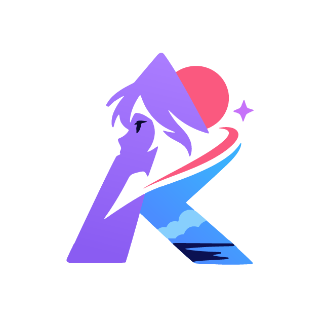
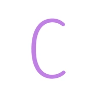
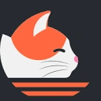

<div align="center">



# Kaisou

### Immersive AniList client for Android

<br/>

[](https://github.com/Zev-Kaapor/Kaisou/releases)
[](https://github.com/Zev-Kaapor/Kaisou/blob/main/LICENSE)
[](https://github.com/Zev-Kaapor/Kaisou)
[](https://github.com/Zev-Kaapor/Kaisou/releases)
[](#download-now)

<br/>

[](#status)
[](#download-now)
[](#features)
[](#translations)
[](#faq)
[](#support-the-project)

</div>

<details><summary><b>📋 Table of Contents</b></summary>

- [🧭 Overview](#overview)
- [📅 Status](#status)
- [⚙️ Features](#features)
- [📥 Download Now](#download-now)
- [🛠️ Build](#build)
- [❓ FAQ](#faq)
- [🌍 Translations](#translations)
- [💖 Support the Project](#support-the-project)
- [✨ Special Thanks](#special-thanks)
- [📜 License](#license)
- [👥 Contributors](#contributors)
- [⚖️ Disclaimer](#disclaimer)

</details>

> [!WARNING]
> **Early version** - Kaisou is being built one screen at a time. Version 0.6.1 has the sign in with AniList, the Home with its shelves and the stories of the people you follow, the page of each anime and manga with the editor of your list, the pages of the characters, the staff and the studios, the pages with all the related titles, the order to watch and read and all the people of a title, the episodes of an anime with their scores and the community of a title, with its reviews and its forum, and some tabs and buttons are still empty. It is a version to be tested, not a finished app.

> [!NOTE]
> **Your privacy** - Kaisou has no server of its own and does not track you. Your AniList access key is kept only on your phone and is left out of the Android backups. The app only talks to the services it needs: AniList for your account and your lists, TMDB, TheTVDB and ani.zip to find the posters, the logos, the ratings and the seasons of each title (the name and the id of the title are sent), IMDb for the score of each episode (the id of IMDb is sent), Jikan, or one of its public mirrors, for the score of each episode on MyAnimeList (the id of MyAnimeList is sent), TVmaze for the score of each episode when the others have none (the id of IMDb or of TheTVDB is sent), MyAnimeList for the age rating (the id of the title is sent), Jikan, or one of its public mirrors, for the openings and the endings of an anime (the id of MyAnimeList is sent), YouTube when a trailer is played, in its own player (the id of the video is sent), MangaDex for the covers of a manga (the name and the id of AniList of the manga are sent), Kuroiru for the news of an anime (the id of MyAnimeList is sent), MangaBaka for the news of a manga (the id of AniList is sent), Google Translate when a synopsis is translated (only the text of the synopsis is sent), the site that hosts a picture when a status of AniList shows one, and GitHub to look for a new version. More in the [FAQ](#faq).

---

<!-- OVERVIEW - Project overview -->
<div align="center">

<h1><a id="overview"></a>Overview</h1>
<em>Kaisou is an AniList client for Android, designed to feel immersive, light and as refined as the big streaming apps.</em>

<br>

<p align="center">An open-source project made with care for the details of every screen, for the people who love anime and manga and keep their lists on AniList.</p>

</div>

---

<!-- STATUS - Where the project is -->
<div align="center">

<h1><a id="status"></a>Status</h1>

</div>

Kaisou grows one small piece at a time, with every screen reviewed on a real phone before the next one begins, and the structure of an earlier app, Wavvy, as the base of its identity. Version 0.0.1 was the first release of the new app, with the sign in and the Home, version 0.1.0 brought the shelves of the Home and the stories, version 0.2.0 brought the page of the title, the editor of your list and the pages of the characters, the staff and the studios, version 0.3.0 brought the related titles, the order to watch and the people of a title, version 0.4.0 brought the age rating of a manga and version 0.5.0 brought the stories that turn like a cube, the bar of the app on the page of a title, the picture of each season and the tab of the episodes with their scores, and version 0.6.0 brought the community of a title read inside the app, with its numbers, its activity, its reviews and its forum.

<details>
<summary><b>📅 Progress by version</b> • every step, from the first version</summary>

<br>

| Step | State |
| :--- | :--- |
| **Project base:** build, signed releases, automated release workflow, logo and icon | ✅ Done, version 0.0.1 |
| **Theme and navigation:** colors, typography and shapes, a bottom bar in portrait and a side rail in landscape | ✅ Done, version 0.0.1 |
| **Sign in:** with AniList in the browser or with a token, kept only on the phone | ✅ Done, version 0.0.1 |
| **Home:** the header with your numbers and the featured titles of the season, with their poster or wide picture, logo, age rating, season and synopsis in your language | ✅ Done, version 0.0.1 |
| **Menu of the account, settings and about:** sign out, the version, the thanks, and the updates that look, download and install the new releases | ✅ Done, version 0.0.1 |
| **Shelves of the Home:** what you are watching and reading, the new episodes, what you plan, the sequels you missed, the recommendations and the discovery of AniList | ✅ Done, version 0.1.0 |
| **Stories:** the activity of the people you follow, to read, like, comment, share and delete, and a screen to write your own status with the formats of AniList | ✅ Done, version 0.1.0 |
| **Explore, Calendar and Library:** the other three tabs | 🔜 Planned |
| **Title page:** the top with your list and the heart, the synopsis, the data with its links, the tags, the trailer, the covers of a manga, the news, the places among the best and the friends that have it | ✅ Done, version 0.2.0 |
| **Editor of your list:** put a title on your AniList list or change it, with the status, the progress, the score in the way your account gives it, the days, the notes and your own lists | ✅ Done, version 0.2.0 |
| **Characters, staff and studios:** the page of each one, with the favourite, the voices in all the languages and all their titles | ✅ Done, version 0.2.0 |
| **Related titles and order to watch or read:** the pages with all the titles tied to one, grouped by the kind of tie, and the whole series in the order to take it, which for an anime is the one of chiaki.site | ✅ Done, version 0.3.0 |
| **Age rating of a manga:** no source rates a manga, so the age is worked out from the tags and the genres that AniList has for it: the tag that weighs most sets the floor when enough people voted on it, and the public of the series, a few tags together and the adult mark move it. It uses the same symbols of the anime, on the page and on the cards, and is an estimate, not an official rating | ✅ Done, version 0.4.0 |
| **Covers of a manga:** the covers of the volumes in a row with a page for all of them, three in each line, and a viewer over the whole screen in the size the picture has, with a swipe to the next cover, zoom with animation and a button to save it | ✅ Done, version 0.3.3 |
| **Characters, staff and voices of a title:** the pages with all of them, each with the beginning of what it says of itself, its spoilers covered, and the voices of a character in every language | ✅ Done, version 0.3.0 |
| **Episodes of an anime:** the seasons or the ranges, each episode with its picture, text in your language, the score people gave it on IMDb, MyAnimeList, TVmaze or TMDB, the mark of what you watched and the next one to watch | ✅ Done, version 0.5.0 |
| **Community of a title:** the activity of the days, the numbers of the title and what people did to it lately, and the reviews and the threads of the forum read inside the app, in your language, with the votes, the hearts, the answers, the bell and the cards of the titles | ✅ Done, version 0.6.0 |
| **Chapters of a manga:** the tab of the chapters, with its own care | 🚧 Basic, to be reviewed |
| **Search and notifications:** the search and the notices of AniList | 🔜 Planned |
| **Your profile and your lists:** the lists of anime and manga, with the progress | 🔜 Planned |
| **Extensions:** support for the sources the user adds, with none of them included | 🔜 Planned |

</details>

---

<!-- FEATURES - What the project does -->
<div align="center">

<h1><a id="features"></a>Features</h1>

</div>

Everything the project does, in groups you can open. ✅ is already done, 🚧 is being built and 🔜 is planned.

<details>
<summary><b>🔜 Planned</b> (what comes next)</summary>

<br>

- The other tabs: Explore, Calendar and Library
- The chapters of a manga, taken further, and the search
- Your lists of anime and manga
- The notices of AniList and your profile
- Extensions for the sources the user adds
- A setting for the country of the age ratings, apart from the language

Do you have another idea? [Open an issue](https://github.com/Zev-Kaapor/Kaisou/issues/new) and tell it.

</details>

<details>
<summary><b>🚧 In progress</b> (what is being built)</summary>

<br>

Nothing is being built right now.

</details>

<details>
<summary><b>✅ Complete</b> (everything the project does today)</summary>

<br>

<table>
  <tr>
    <td width="50%" valign="top">

#### 🔐 Account
- Sign in with your **AniList** account, in the browser or with a token
- The access key stays only on the phone and is left out of the Android backups
- Sign out whenever you want, and revoke the access in the settings of AniList

#### 🏠 Home
- The header with your name, the episodes you watched and the chapters you read
- The **featured titles** of the season, one at a time, in a carousel that you can swipe
- The **poster** in high quality when standing up and a **wide picture** when lying down, chosen from TMDB and TheTVDB, with the cover of AniList as the last choice
- The **logo** of the title in place of its name, when there is one that can be seen
- The **age rating** of your country, with the official Brazilian symbols, and a square with the age and a plus in the other countries
- The **season** of the title and the tag of the day of the week of its new episode
- The **synopsis in your language**, translated when it is not English
- The **shelves** under it: continue watching and reading, the new episodes, what you plan, the sequels you missed, the recommendations, what is trending, popular, coming and new, in cards with the score, the age rating and how far you are
- Pull down to look again, and the news of your friends come by themselves when the app opens and every few minutes

#### 📺 Title
- The top with the poster or the wide picture, the logo, the score, your list, the **heart** of your favourites and the **bell** of the release alerts
- The synopsis in your language, the next episode with its countdown, and the **prequel and the sequel** one tap away
- The **bar of the app stays** on the page of a title and changes to its three sections, **details**, **episodes or chapters** and **community**, with the icons going out and the new ones coming in
- The **season or the part** of the title under its logo, as Season 2 or Season 1, Part 2, and **its own poster and backdrop** for each season after the first, from TMDB and TheTVDB
- The places among the best with a star that is gold, silver and bronze for the first three, the data, all the tags with the ones that give away the story hidden, the trailer, which plays inside the page, the **covers of the volumes** of a manga from MangaDex, what is tied to it, the whole series in order, the characters, the staff, what people recommend and where to watch
- The **openings and the endings** with their songs and the episodes they play in, from MyAnimeList, and under them the **news** of the title, from Anime News Network by Kuroiru for an anime and from MangaBaka for a manga
- The friends that have it in a row, you first, with the score they gave, where it is on their list and how far they are
- The **season**, the **hashtags** and the **genres** are links, and the weighted score has a hint that opens the page of the forum that explains it
- The tags in the order of the letters or of the percentage, and the one you choose stays
- Your score next to the one of AniList, with a person that says it is yours

#### 🗣️ Community of a title
- The **activity of the days** in bars, with the day and its number that a touch or a drag picks, and how many people have the title and made it a favourite
- What people **did to the title lately**, as watched episodes 1 - 5 or completed, with their picture, and a touch opens their page
- The **reviews** inside the app, the most useful first, with the whole text in your language, the score, the day and the spoilers covered, and a button to share and the thumbs to vote
- The **forum** in cards with the picture of who opened each thread, and the thread read whole, with its tags, its comments and their answers, in your language
- The link to a title in a thread or in a comment comes as a **card** with its cover, its name and its format
- **Like** the thread and the comments, **answer**, **follow** the thread with the bell, copy and report, and a button turns the translation off

#### 📝 Your list
- Put a title on your **AniList list** or change it, from the page of the title or from the featured title of the Home
- The status, the progress with the buttons and the number, the **score in the way your account gives it** (a number of 10 or of 100, stars or faces), the days it started and ended, the notes, the times done again and your own lists
- A title made done gets the day it ended in one tap, and goes back if you change your mind
- Your score shows on every card, next to the one of AniList, and the Home asks again as soon as your list changes

#### 🎭 Characters, staff and studios
- The page of each one with the picture, the **favourite**, share, the description in your language with the spoilers covered, and the data that came with it
- The **voices** in the language you choose, and all their titles by tab, sort and year
- They open from the rows of the page of a title

#### 💬 Activity of the people
- A **story** for each person you follow, with a piece of the ring for each thing they did in the last days, gray when you already saw it
- The stories change from a person to another over a **cube** that turns with your finger: any swipe to the side goes to the next person, or closes when there is none, and a swipe the other way goes back, or starts again at the first one
- A tap on the left or on the right goes back or forward, a tap in the middle opens the title the activity is about, the picture or the name of the person opens their page, and a hold stops the story
- The story that is open stays where it was when the phone is turned
- Read what they did, **like** it, **comment** and **share** it, and delete your own
- On the comments: like, change or delete yours, and open the profile of who wrote
- A screen to **write your own status**, with the formats of AniList, a preview and a warning before it is posted
- Links, pictures and videos of the text open or show as the site does, in a browser that stays over the app

#### 🎞️ Episodes of an anime
- The **seasons** as chips when the series has two or more, and otherwise **ranges** of 25, 50 or 100 episodes, with the one you are on open
- Each episode with its **picture**, its number, its **score**, its day, its length and its text, which opens with a touch
- The names and the texts **in your language**, from TMDB and, for what it has not, by Google Translate
- The **score** people gave each episode, from IMDb first, then MyAnimeList, TVmaze and TMDB, as each one answers
- A **long press** marks how far you are, and the island says what was done: the status follows what you do, never going back to planned
- The next episode to watch has a ring and a card to continue, and the list can be sorted from the first or from the last

#### 🎨 Look
- A dark theme with a violet identity, made for the night
- Every screen **standing up and lying down**, with a bar at the bottom or a rail at the side
- Placeholders with the shape of what is coming, so nothing jumps

</td>
    <td width="50%" valign="top">

#### 🔄 Updates
- Looks at the releases of the app by itself, every time it opens and every few hours
- Downloads the file that fits your phone and installs it
- Shows what changed in each version, and translates it
- Choose how often to look, or pause the lookups

#### 🌍 Languages
- **English** and **Brazilian Portuguese**, the one of your phone by default

#### ⚡ Light and fast
- Pictures, ratings and translations are kept on the phone, so opening the app again does not ask for them again
- The Home shows as soon as the hero and the top of the shelves are there, and the rest comes in as it is ready
- Each service has a limit of requests at once, and the app waits when one asks it to rest
- A small app, around 2 MB

#### ℹ️ About
- The version, the author, the license and the page of the project
- The thanks to every project, site and app that made Kaisou possible

</td>
  </tr>
</table>

</details>

<div align="center">

<br>

<em>Built with <b>Kotlin</b> and <b>Jetpack Compose</b> for a result that feels fast, responsive and beautiful.</em>

</div>

---

<!-- DOWNLOAD - Downloads -->
<div align="center">

<h1><a id="download-now"></a>Download Now</h1>

[](https://github.com/Zev-Kaapor/Kaisou/releases)

</div>

A new release with signed APKs is published on GitHub every time the app version changes. Pick the one that fits your phone:

| APK | When to use it |
| :--- | :--- |
| **arm64-v8a** | Most phones from 2017 onwards, the best choice for almost everyone. |
| **armeabi-v7a** | Older 32-bit phones. |
| **universal** | Works on any phone, in a larger file. Pick this one if you are not sure. |

Kaisou needs **Android 8.0 (API 26)** or newer. To install, open the file on your phone and, when Android asks, allow your browser or your file manager to install apps.

After the first install the app looks for a new version by itself: every time it opens and every few hours, and it tells you with a notification. In **Settings → About → Versions** you can see what changed, download and install it, choose how often to look or pause the lookups. This works as long as the first install also came from here, because an app built in Android Studio is signed with another key and cannot be replaced by a release.

---

<!-- BUILD - Build from source -->
<div align="center">

<h1><a id="build"></a>Build</h1>

</div>

To build Kaisou yourself you need:

- **Android Studio** in a current version, or only the command line
- **Android SDK Platform 37**, which Android Studio offers to install when you open the project
- **A JDK 21 or newer** to start Gradle. The releases of the project are built with JDK 25
- An internet connection on the first build, to download Gradle and the libraries

**1. Get the code**

```bash
git clone https://github.com/Zev-Kaapor/Kaisou.git
cd Kaisou
```

**2. Build a version to test**

In Android Studio, open the folder, wait for the sync and press Run with your phone connected. Or in the terminal, on Windows with `gradlew.bat` in place of `./gradlew`:

```bash
./gradlew assembleDebug
```

The APKs, one for each kind of phone and a universal one, are in `app/build/outputs/apk/debug/`. To put one on your phone with adb:

```bash
adb install -r app/build/outputs/apk/debug/app-arm64-v8a-debug.apk
```

**3. Build a release**

```bash
./gradlew assembleRelease
```

The APKs are in `app/build/outputs/apk/release/`, smaller than the debug ones because the code and the resources are shrunk. The releases of the project are signed with its own key, which is kept in the secrets of the repository. A build of yours is signed with the debug key, so it installs, but it does not update one of the releases and the other way around: one has to be removed before the other is installed.

**4. The keys of the services**

Kaisou asks the services for the pictures, the ratings and the sign in, and each one needs a key of yours, which the services give for free. Put them in the file `local.properties` at the root of the project, which Git does not keep:

```properties
anilist.clientId=your client id
anilist.pinClientId=your second client id
tmdb.token=your read access token
tvdb.key=your project key
mal.clientId=your client id
```

For the sign in, register a client on [AniList](https://anilist.co/settings/developer) with the redirect address `kaisou://anilist`. The sign in with a token opens a page of AniList that shows the token to copy, which needs a second client with the redirect address `https://anilist.co/api/v2/oauth/pin`, and its id goes in `anilist.pinClientId`. The other keys come from [TMDB](https://www.themoviedb.org/settings/api), [TheTVDB](https://thetvdb.com/api-information) and [MyAnimeList](https://myanimelist.net/apiconfig).

Without them the app builds and works with less: no key of AniList means no sign in in the browser, and without the second one the sign in with a token asks for a token that the user makes by hand, without the keys of TMDB and TheTVDB the featured titles show the cover of AniList, and without the one of MyAnimeList the age rating of a country that has none is not found.

**How a release is made**

The workflow in `.github/workflows/release.yml` publishes a release when `appVersionName` changes in `app/build.gradle.kts`. It builds and signs the APKs, writes the notes from the commits since the last release and publishes them on GitHub. It reads the key of the signing and the keys of the services from the secrets of the repository: `KEYSTORE_BASE64`, `KEYSTORE_PASSWORD`, `KEY_ALIAS`, `KEY_PASSWORD`, `ANILIST_CLIENT_ID`, `ANILIST_PIN_CLIENT_ID`, `TMDB_TOKEN`, `TVDB_KEY` and `MAL_CLIENT_ID`.

---

<!-- FAQ - Frequently asked questions -->
<div align="center">

<h1><a id="faq"></a>FAQ</h1>

</div>

<details>
  <summary><b>Is Kaisou free to use?</b></summary>
  <br>
  Yes, Kaisou is completely free and open-source, with no ads, no premium subscriptions and no hidden costs.
  <br>
</details>

<details>
  <summary><b>Do I need an AniList account?</b></summary>
  <br>
  Yes. Kaisou is a client for AniList, so it opens only for a signed in user. If you do not have an account yet, the sign in screen has a link to create one for free.
  <br>
</details>

<details>
  <summary><b>Is it safe to sign in?</b></summary>
  <br>
  The sign in happens in your browser, on the site of AniList, and AniList sends the access key back to the app. The key is kept only on your phone, Kaisou has no server of its own and the key is left out of the Android backups. AniList has no limited permissions, so the key gives access to almost everything in your account, and you can revoke it at any time in the settings of your AniList account.
  <br>
</details>

<details>
  <summary><b>Does Kaisou play anime?</b></summary>
  <br>
  Not for now. Kaisou shows the catalog and your lists. It does not host, store or provide any video, and the support for sources that the user adds is planned, with none of them included.
  <br>
</details>

<details>
  <summary><b>Is the app ready to use?</b></summary>
  <br>
  Not yet. Version 0.6.1 has the sign in, the Home with its shelves and the stories, the page of the title with the editor of your list, the episodes of an anime with their scores and the community with its reviews and its forum, the pages of the characters, the staff and the studios, and the pages with the related titles, the order to watch and all the people of a title, and some tabs and buttons are still empty. See what it does in the <a href="#features">Features</a> section.
  <br>
</details>

<details>
  <summary><b>Which APK should I download?</b></summary>
  <br>
  Most phones from 2017 onwards can use <b>arm64-v8a</b>, and older 32-bit phones need <b>armeabi-v7a</b>. If you are not sure, take the <b>universal</b> one, which works on any phone in a larger file.
  <br>
</details>

<details>
  <summary><b>Which Android versions does it support?</b></summary>
  <br>
  Android 8.0 (API 26) and newer.
  <br>
</details>

<details>
  <summary><b>How do I update the app?</b></summary>
  <br>
  The app looks for a new version by itself, every time it opens and every few hours, and tells you with a notification. In <b>Settings → About → Versions</b> you can see what changed, download and install it, choose how often to look or pause the lookups. This works if the first install also came from the releases here, because an app built by another key, such as one made in Android Studio, cannot be replaced by a release.
  <br>
</details>

<details>
  <summary><b>Why does a title show the cover instead of the poster?</b></summary>
  <br>
  The posters, the logos and the wide pictures come from TMDB and TheTVDB, and some titles, mostly the newest ones, are not there yet. When there is nothing sharp enough, Kaisou shows the cover of AniList and the name of the title in text.
  <br>
</details>

<details>
  <summary><b>Where do the scores of the episodes come from?</b></summary>
  <br>
  Each episode takes the first score that is found: the one of IMDb, then the one of MyAnimeList, then the one of TVmaze and then the one of TMDB. AniList has no score for episodes. IMDb does not have an open API for them, so Kaisou asks the same GraphQL door that its own site uses, which needs no key and gives all the episodes of a series in a page or a few. That door is not documented, so it can change, and then the other sources are used. The answer is kept for a week. An episode that none of them scored, or that too few people scored, shows no score.
  <br>
</details>

<details>
  <summary><b>Where does the age rating come from?</b></summary>
  <br>
  From the rating that the country of your phone gives to the title, as TMDB has it, with the official symbols for Brazil. When your country has none, the rating of MyAnimeList is used, and then the one of another country, as an approximation, and the screen readers say so. A manga has no rating on those sources, so it shows NR, not rated, or 18+ when AniList marks it for adults. An anime nobody rated yet shows RP, rating pending.
  <br>
</details>

<details>
  <summary><b>Does it collect my personal data?</b></summary>
  <br>
  No. Kaisou has no server of its own and no analytics. Your access key and your account stay on your phone. The services it talks to are listed in the note at the top of this page.
  <br>
</details>

<details>
  <summary><b>What license does the project use?</b></summary>
  <br>
  Kaisou is free software under the <a href="https://github.com/Zev-Kaapor/Kaisou/blob/main/LICENSE">GNU General Public License v3.0</a>. You can use it, study it, change it and share it, as long as the changes you share stay under the same license.
  <br>
</details>

<details>
  <summary><b>How do I report a bug?</b></summary>
  <br>
  <a href="https://github.com/Zev-Kaapor/Kaisou/issues/new">Open an issue</a> and tell what you did, what you expected and what happened. Mention the version of the app, the model of your phone and the version of Android.
  <br>
</details>

<details>
  <summary><b>How can I contribute?</b></summary>
  <br>
  Open an issue with a bug, an idea or a text that is not right, or send a pull request. Kaisou is built one screen at a time, so it is best to talk about it in an issue first.
  <br>
</details>

<div align="center">

<h3>More questions? <a href="https://github.com/Zev-Kaapor/Kaisou/issues">Open an issue on GitHub!</a></h3>

</div>

---

<!-- TRANSLATIONS - Translations -->
<div align="center">

<h1><a id="translations"></a>Translations</h1>

</div>

The app is available in **English**, which is the default, and **Brazilian Portuguese**, and it uses the one of your phone. The texts are in `app/src/main/res/values` and `app/src/main/res/values-pt-rBR`.

Found a text that is not right? [Open an issue](https://github.com/Zev-Kaapor/Kaisou/issues/new) or send a pull request with the fix. Want to see another language? Tell which one in an issue.

---

<!-- SUPPORT - Support the project -->
<div align="center">

<h1><a id="support-the-project"></a>Support the Project, Visitor! 👋</h1>

<h3>Kaisou is free and open-source. If you liked it, a star on this repository is the best way to say thanks! ⭐</h3>

<a href="https://github.com/Zev-Kaapor/Kaisou">
  
</a>

<h5>A star, a share with a friend or a <a href="https://github.com/Zev-Kaapor/Kaisou/issues/new">suggestion</a> already means a lot. Thank you! 💙</h5>

</div>

---

<!-- ACKNOWLEDGMENTS - Special thanks -->
<div align="center">

<h1><a id="special-thanks"></a>Special Thanks</h1>

<h3>Kaisou stands on the shoulders of incredible open-source work!</h3>

<h3>Projects and Inspirations</h3>

<table>
  <thead>
    <tr>
      <th></th>
      <th align="center">Project</th>
      <th align="center">Author</th>
      <th align="center">What it brought</th>
    </tr>
  </thead>
  <tbody>
    <tr>
      <td align="center"></td>
      <td><strong><a href="https://github.com/PierfrancescoSoffritti/android-youtube-player">android-youtube-player</a></strong></td>
      <td><a href="https://github.com/PierfrancescoSoffritti">PierfrancescoSoffritti</a></td>
      <td>The player that plays the trailers inside the page</td>
    </tr>
    <tr>
      <td align="center"></td>
      <td><strong>AniList &amp; ani.zip</strong></td>
      <td><a href="https://anilist.co">AniList</a></td>
      <td>The catalog, the lists and the account of the user, and the link between their ids and the ones of the other sites</td>
    </tr>
    <tr>
      <td align="center"></td>
      <td><strong><a href="https://github.com/RyanYuuki/AnymeX">AnymeX</a></strong></td>
      <td><a href="https://github.com/RyanYuuki">RyanYuuki</a></td>
      <td>Inspiration for the pages of the title and for the order to watch</td>
    </tr>
    <tr>
      <td align="center"></td>
      <td><strong>Chiaki</strong></td>
      <td><a href="https://chiaki.site">Chiaki</a></td>
      <td>The order to watch the anime, made by hand</td>
    </tr>
    <tr>
      <td align="center"></td>
      <td><strong>Crunchyroll</strong></td>
      <td><a href="https://www.crunchyroll.com">Crunchyroll</a></td>
      <td>Inspiration for the look of the Home and of the title</td>
    </tr>
    <tr>
      <td align="center"></td>
      <td><strong><a href="https://github.com/itsmechinmoy/Dantotsu">Dantotsu</a></strong></td>
      <td><a href="https://github.com/rebelonion">rebelonion</a></td>
      <td>Inspiration for the header, for a client of AniList and for how the progress of the list follows the episodes</td>
    </tr>
    <tr>
      <td align="center"></td>
      <td><strong>Google Translate</strong></td>
      <td><a href="https://translate.google.com">Google LLC</a></td>
      <td>The translation of the synopses and of the names and texts of the episodes, through its public endpoint</td>
    </tr>
    <tr>
      <td align="center"></td>
      <td><strong>Kuroiru</strong></td>
      <td><a href="https://kuroiru.co">Kuroiru</a></td>
      <td>The news of the anime, with the headlines of Anime News Network</td>
    </tr>
    <tr>
      <td align="center"></td>
      <td><strong>IMDb</strong></td>
      <td><a href="https://www.imdb.com">IMDb</a></td>
      <td>The score people gave each episode, which comes first</td>
    </tr>
    <tr>
      <td align="center"></td>
      <td><strong>Jikan</strong></td>
      <td><a href="https://jikan.moe">Jikan</a></td>
      <td>The openings and the endings of the anime and the score of their episodes, from MyAnimeList</td>
    </tr>
    <tr>
      <td align="center"></td>
      <td><strong>MangaBaka</strong></td>
      <td><a href="https://mangabaka.org">MangaBaka</a></td>
      <td>The news of the manga</td>
    </tr>
    <tr>
      <td align="center"></td>
      <td><strong>MangaDex</strong></td>
      <td><a href="https://mangadex.org">MangaDex</a></td>
      <td>The covers of the volumes of the manga</td>
    </tr>
    <tr>
      <td align="center"></td>
      <td><strong>MyAnimeList</strong></td>
      <td><a href="https://myanimelist.net">MyAnimeList</a></td>
      <td>The age rating of the anime and the score of their episodes</td>
    </tr>
    <tr>
      <td align="center"></td>
      <td><strong>TVmaze</strong></td>
      <td><a href="https://www.tvmaze.com">TVmaze</a></td>
      <td>The score of the episodes when the other sources have none</td>
    </tr>
    <tr>
      <td align="center"></td>
      <td><strong>TheTVDB</strong></td>
      <td><a href="https://www.thetvdb.com">TheTVDB</a></td>
      <td>The posters, the backdrops, the logos, the seasons of the series and the picture of each season</td>
    </tr>
    <tr>
      <td align="center"></td>
      <td><strong>TMDB</strong></td>
      <td><a href="https://www.themoviedb.org">TMDB</a></td>
      <td>The posters, the backdrops, the logos, the age ratings and the names, the texts and the scores of the episodes</td>
    </tr>
    <tr>
      <td align="center"></td>
      <td><strong><a href="https://tomatoanimes.com/d/latest">Tomato</a></strong></td>
      <td><a href="https://tomatoanimes.com/d/latest">Tomato</a></td>
      <td>Inspiration for the details of the title and for the tag of the weekly release</td>
    </tr>
    <tr>
      <td align="center"></td>
      <td><strong><a href="https://github.com/Zev-Kaapor/Wavvy">Wavvy</a></strong></td>
      <td><a href="https://github.com/Zev-Kaapor">Zev-Kaapor</a></td>
      <td>The structure, the identity and the way of building the screens</td>
    </tr>
    <tr>
      <td colspan="4" align="center"><em>and more amazing open-source projects</em></td>
    </tr>
  </tbody>
</table>

<h3>Thanks to the Services</h3>

<p>Thank you to <strong>AniList</strong>, which gives the catalog, the lists and the sign in, to <strong>TMDB</strong>, to <strong>TheTVDB</strong> and to <strong>MyAnimeList</strong>, which give the pictures, the seasons, the ratings, the trailers and the episodes, to <strong>IMDb</strong> and to <strong>TVmaze</strong>, which give the score of the episodes, to <strong>Jikan</strong> and to the public mirrors of the community, which give the openings, the endings and the score of the episodes from MyAnimeList, to <strong>Chiaki</strong>, which gives the order to watch the anime, to <strong>Kuroiru</strong> and <strong>MangaBaka</strong>, which give the news, to <strong>MangaDex</strong>, which gives the covers of the volumes of the manga, to <strong>Google Translate</strong>, which translates the texts, and to <strong>GitHub</strong>, which holds the releases that the updates look for.<br>
<em>This product uses the TMDB API but is not endorsed or certified by TMDB. Metadata provided by <a href="https://www.thetvdb.com">TheTVDB</a>. Information courtesy of <a href="https://www.imdb.com">IMDb</a>. Kaisou is independent and is not affiliated with or endorsed by any of them.</em></p>

<h3>Development Helpers</h3>

<table>
  <thead>
    <tr>
      <th></th>
      <th align="center">Person</th>
      <th align="center">What it brought</th>
    </tr>
  </thead>
  <tbody>
    <tr>
      <td align="center"></td>
      <td><strong><a href="https://www.instagram.com/walppxk">Walppxk</a></strong></td>
      <td>Beta Tester and QA Analyst</td>
    </tr>
  </tbody>
</table>

<h3>Helper Tools</h3>

<table>
  <thead>
    <tr>
      <th></th>
      <th align="center">Tool</th>
      <th align="center">What it brought</th>
    </tr>
  </thead>
  <tbody>
    <tr>
      <td align="center"></td>
      <td><a href="https://claude.com/claude-code"><strong>Claude Code</strong></a></td>
      <td>Development assistant and Tech Lead</td>
    </tr>
  </tbody>
</table>

<h3>Core Technologies</h3>

<table>
  <thead>
    <tr>
      <th align="center">Library/Tool</th>
      <th align="center">Contribution</th>
    </tr>
  </thead>
  <tbody>
    <tr>
      <td><strong>Jetpack Compose</strong></td>
      <td>Modern, fluid Android UI framework</td>
    </tr>
    <tr>
      <td><strong>Material Design 3</strong></td>
      <td>Design system and theming</td>
    </tr>
    <tr>
      <td><strong>Navigation &amp; WorkManager</strong></td>
      <td>The screens, and the check for new versions in the background</td>
    </tr>
    <tr>
      <td><strong>Coil</strong></td>
      <td>Image loading and its cache</td>
    </tr>
    <tr>
      <td><strong>Poppins</strong> (Indian Type Foundry)</td>
      <td>The typeface of the app, under the SIL Open Font License</td>
    </tr>
  </tbody>
</table>

<h3>Thank you to the entire open-source community! Every library and tool that powers this project!</h3>

</div>

---

<!-- LICENSE - License -->
<div align="center">

<h1><a id="license"></a>License</h1>

</div>

Kaisou is licensed under the **GNU General Public License v3.0**, see the [LICENSE](LICENSE) file. The pictures, the logos and the data of each title belong to their owners and to the services that give them, under the terms of each one.

---

<!-- CONTRIBUTORS - Contributors -->
<div align="center">

<h1><a id="contributors"></a>Contributors</h1>

<h3>This project wouldn't exist without these amazing people, and everyone who helps with code, ideas, tests and translations!</h3>

<a href="https://github.com/Zev-Kaapor/Kaisou/graphs/contributors">
  
</a>

<h5>Want to contribute? <a href="https://github.com/Zev-Kaapor/Kaisou/issues/new">Open an issue</a> with a bug, an idea or a text that is not right!</h5>

</div>

---

<!-- DISCLAIMER - Legal notice -->
<div align="center">

<h1><a id="disclaimer"></a>Disclaimer</h1>

Kaisou is an open-source, non-commercial project developed for educational and personal use. This project is **not affiliated with, funded, authorized, endorsed by, or associated** with AniList, TMDB, TheTVDB, MyAnimeList, IMDb, TVmaze, Crunchyroll, Google LLC, or any of their affiliates and subsidiaries.

The names, the logos, the posters and the data of the titles belong to their owners and come from AniList, TMDB, TheTVDB, MyAnimeList, IMDb, TVmaze, Jikan, Kuroiru, MangaBaka and MangaDex, with which Kaisou has no agreement. If you own any of them and want it out of the app, open an issue and it will be taken out.

All trademarks, service marks, and intellectual property rights referenced in this project belong to their respective owners. Kaisou does not host, store, or distribute any copyrighted media; it functions strictly as a client interface for publicly available content provided via third-party APIs.

</div>

---

<div align="center">

<br/>

**Made with 💙 by [Zev Kaapor](https://github.com/Zev-Kaapor)**

</div>
